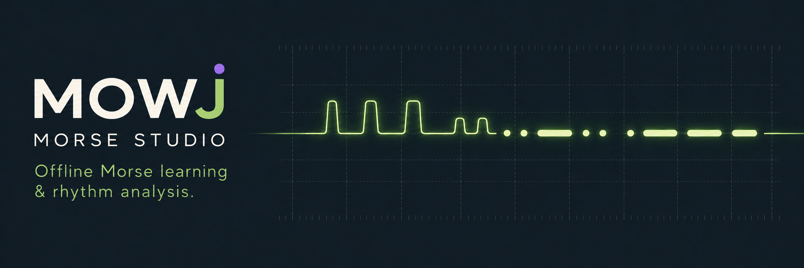
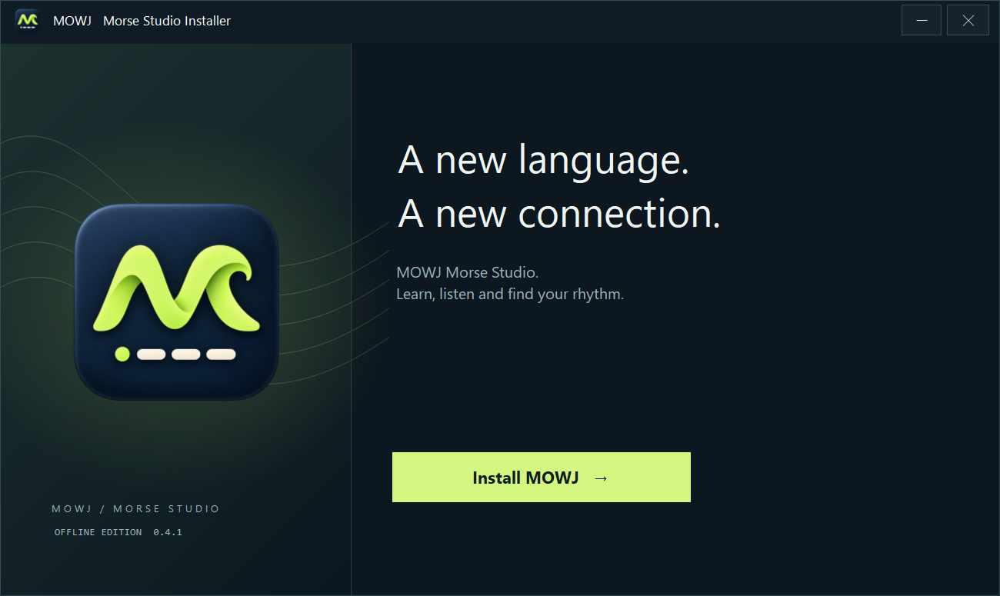

# MOWJ — Morse Studio



An offline studio for learning Morse code, practising transmission rhythm and following a coastal rescue story. Built by Jey as part of the Vega project family.

[راهنمای فارسی](README-fa.md) · [Validation report](docs/VALIDATION.md) · [Third-party notices](THIRD_PARTY.md)



## What you can do

- Explore the international letters and digits through an interactive signal tree.
- Listen, repeat and practise short on-air messages.
- Use a two-key telegraph desk or hold Space as a straight key.
- Compare recorded timing with Morse duration and spacing references.
- Play The Silent Station: 14 story contacts with reception, decoding and relay tasks, coastal artwork, optional radio noise, saved progress and mission PDF records.
- Choose Day, Night or System appearance and keep progress locally.

Persian character mapping is experimental and has not been verified as an authoritative standard. Story missions are fictional training scenarios, not emergency operating instructions. No radio transmission or hardware connection is implemented.

## Downloads

Get the [Windows installer and standalone HTML from Releases](https://github.com/mj0five/MOWJ-Morse-Studio/releases/latest). Verify downloads with the accompanying SHA256SUMS.txt. The Windows installer is unsigned.

## Run without installing

From this repository, with Node.js available:

```text
npm run build:web
```

Open the generated `mowj-offline.html` in a modern browser. It contains the app and artwork; no server, account or internet connection is needed to practise. Sound is synthesized locally with Web Audio and requires a user gesture to start.

If opening `app/index.html` directly, run the build first: it generates `app/story.js`. Neither generated file is tracked in Git.

## Controls

| Key | Action |
| --- | --- |
| Left / Right | Dot / dash in two-key mode |
| Space | Word separation in two-key mode; hold/release in straight-key mode |
| Enter | Commit/check the current character or answer |
| R / N | Replay / next where available |
| Shift | Clear/restart the current input according to the active exercise |

Text fields retain normal editing behaviour. Morse messages need character boundaries; continuous SOS is supported as a prosign. Story missions display their own control instructions.

## Rhythm analysis

On the telegraph desk, record at least three signals, release Space and choose **Analyze rhythm**. Straight-key mode evaluates held durations and spacing; two-key mode evaluates spacing only. Generated tone lengths are not treated as measured key-hold skill. The reference uses 1/3/7 Morse units and a 30% interval tolerance. This is a timing comparison, not a certification or message-accuracy score.

## Windows build

The Windows package uses Electron. Version 0.4.1 is the initial public release prepared for publication. The Windows installer is unsigned and intended for Windows 10/11 x64; clean-machine compatibility remains unverified.

Build with Node.js and the Windows .NET Framework C# compiler:

```powershell
.\scripts\build-windows.ps1
```

The script downloads a pinned official Electron runtime, verifies its SHA-256 and writes `dist/MOWJ-Setup-0.4.1-win-x64.exe`. It does not install or launch the app. For an offline build, supply an existing matching archive:

```powershell
.\scripts\build-windows.ps1 -ElectronArchive "C:\path\electron-v45.2.1-win32-x64.zip"
```

Use a PowerShell session that permits your reviewed local scripts; no permanent execution-policy change is required by this project. Build/test binaries belong in ignored output folders, not source commits. Distribution of the installer should follow release testing; this README does not imply that a public release already exists.

## Local data and privacy

The browser app stores profile, preferences, recent practice history and story progress in localStorage. Storage belongs to the browser/profile and origin; persistence for `file:` URLs is browser-dependent. Clearing browser data or moving the file can affect available progress. Practice remains possible when storage is unavailable.

The desktop app uses a separate profile under `%APPDATA%\MOWJ Morse Studio`; existing browser progress is not imported automatically. The desktop wrapper blocks HTTP(S)/WebSocket requests from its session. Optional HTTPS reference links open in the system browser when selected. This is not an independent security audit.

History/reset controls target MOWJ keys, leaving unrelated browser data alone. The uninstaller is designed to preserve practice records; retention was not revalidated through a full installation/uninstallation in the latest smoke test.

## Test and validation

```text
npm test
npm run build:web
```

On Windows:

```powershell
.\scripts\test-layout.ps1
```

On 2026-11-01, all three source test suites, the standalone web build and installer/uninstaller layout assertions at 100%, 125%, 150% and 200% passed. A desktop smoke test reached onboarding, overview and the first story contact using an isolated profile. This does not establish complete mission, audio, PDF or clean-machine acceptance. See [the exact test scope and remaining checks](docs/VALIDATION.md).

## Source layout

```text
app/          Web source, story artwork and tests
assets/       App logo and Windows icon
desktop/     Electron entry point and pinned runtime metadata
installer/    Setup, uninstall and executable-icon sources
scripts/      Web/Windows build and layout checks
tests/        Installer/uninstaller layout assertions
docs/         Validation, release notes and preview images
```

## Artwork and licensing

The project owner confirms that all included images are AI-generated. See [ARTWORK.md](docs/ARTWORK.md) for provenance notes. AI generation alone does not determine third-party rights or assign a distribution license.

The original project source, documentation and included project artwork are distributed under the [MIT License](LICENSE), copyright (c) 2026 Jey (mj0five). This does not relicense third-party components or grant rights to third-party trademarks. Electron and bundled components retain their own licenses and notices; see [THIRD_PARTY.md](THIRD_PARTY.md).

## Future work

Verify the Persian mapping, improve rhythm feedback, add adaptive drills and investigate audio export or optional hardware connectivity. Microphone decoding and radio hardware transmission are not implemented.
